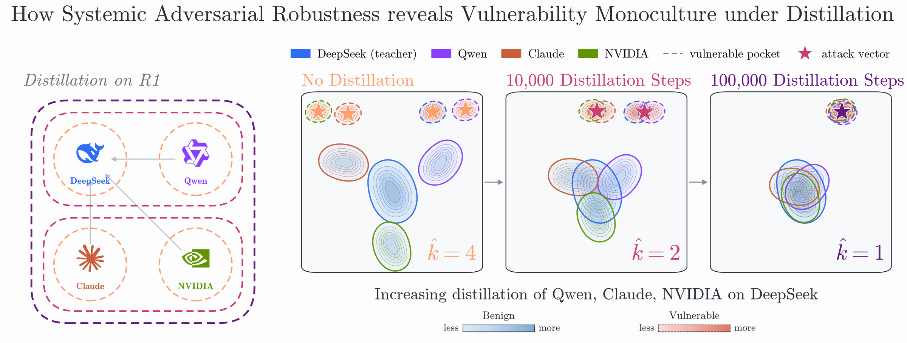
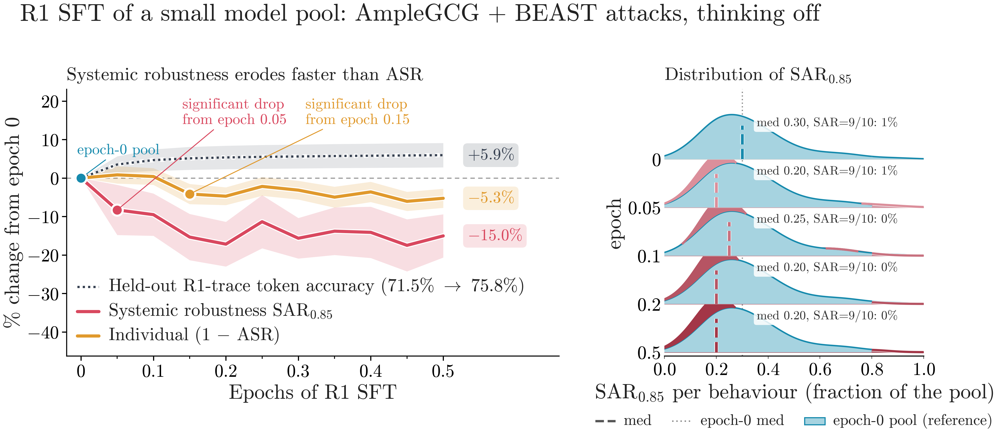
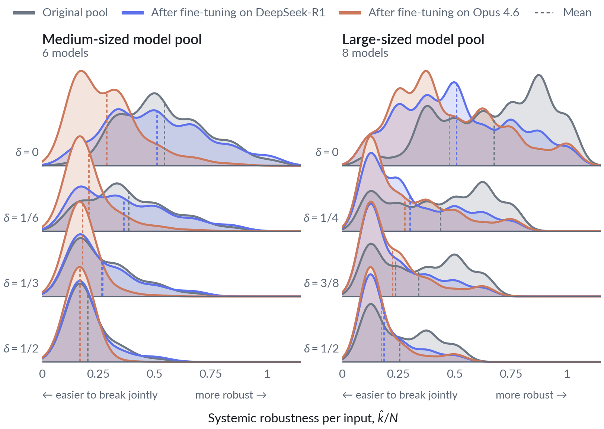

## Bred to Break: What a 1970 Corn Blight Teaches Us About Distilled LLMs

By 1970, most of US corn production relied on a single shared trait, a type of cytoplasm known as “Texas male-sterile,” since it made seed production cheaper. While there was plenty of genetic variety across the different corn hybrids, nearly all of them shared this same cytoplasm, and with it the same weakness. In 1970, a new strain of a disease named Southern corn leaf blight (SCLB), which targeted exactly this cytoplasm, swept across the country. The epidemic ruined around 15% of the national corn yield, making SCLB one of the economically worst crop diseases of the 20th century. The solution was simple: diversification. Moving away from the shared cytoplasm made seed production more involved, but drastically reduced the chance of costly, widespread events like this one. 

But what does corn really have to do with artificial intelligence and large language models? Well, today’s LLMs have also converged towards a monoculture, using similar architectures, relying on largely overlapping training corpora, and, at their most extreme, directly learning from one another through distillation. On the surface this seems good, since highly capable models can be trained efficiently, with learnings from one transferring to another. So just like corn in the 1970s, modern AI has found its own cheap seed production, which comes with all its upsides, but also all its drawbacks. Because just like the corn hybrids, models that look different on the surface can share the same weakness underneath, inherited from a common source. And as it turns out, this makes pools of models with shared properties easier to break as a group: it takes fewer distinct attacks to compromise most of the pool, even when each model looks harder to attack on its own. 

While we do have metrics to measure the effectiveness of attacks and the robustness of models, they tend to look at models and attacks as individual units rather than as a group. For instance, attack success rate measures how often an attack method manages to break a single, fixed model across a set of inputs. Transferability, on the other hand, takes an attack crafted on one model and checks how well it works on other models. Both give valuable insights, but neither captures how vulnerabilities are shared across a pool of models, and therefore how the pool behaves when attacked simultaneously. 

For example, take two separate pools of four LLMs each, where every model is breakable on its own. In the first pool, a single attack compromises all four models. In the second pool, each model needs its own attack, so four separate attacks are required. Attack success rate can’t tell them apart, and transferability only tells us how far a single attack reaches, not how many we need to cover the rest. Yet the two pools clearly exhibit very different robustness patterns. The reality often sits in between these two extremes, where some attacks break a few models and others just one. This raises a new question: how many distinct attacks are needed to compromise most of a pool of models? 

To answer this question, we introduce Systemic Adversarial Robustness (SAR): the fewest distinct attacks needed to compromise a chosen share of a model pool (say, 90% of its models), divided by the size of the pool. In other words, SAR measures how diverse attacks need to be to break a pool of models. In our toy example, the first pool has a SAR of 1/4, while the second has a SAR of 4/4. A low SAR means a handful of attacks go a long way, much like the shared cytoplasm in 1970s corn. A high SAR means vulnerabilities are spread out, and each model needs its own attack. 

To show that systemic robustness captures something commonly used metrics miss, we distil a pool of ten small large language models from a single, shared teacher model. We see that not only does SAR show signs of decreased robustness sooner than attack success rate, but its effects are also far more pronounced (Figure 1): after distillation, SAR has dropped by 15%, while individual robustness has dropped by just over 5%. Figure 1 helps establish SAR as a more responsive metric for capturing robustness changes in model pools. In other words, giving every model the same teacher is like giving every corn hybrid the same cytoplasm: each plant may look just as healthy, but a single disease can now ruin far more of the yield. 

The same pattern is further underlined when looking at LLMs with a higher parameter number and more sophisticated teachers. We take a pool of five Qwen models and one Llama model ranging from 1.5B to 32B parameters. In addition, we look at a second pool of eight models from a more diverse set of five different model providers ranging from 4B to 32B parameters. The specific fine-tuning regime for these models is distillation, first on thinking traces produced by Deepseek-R1 and then further distillation on Opus 4.6 traces. In both instances, we can see that the distilled variants of models are less robust than the original models (Figure 2) with the trend becoming more pronounced after the second distillation step. Interestingly, the 6x6 and 8x8 pools behave in somewhat opposite ways. At its worst, in the 6x6 pool we only see a ~6% drop in mean systemic robustness after fine-tuning on R1 traces followed by another 40% drop after Opus 4.6 distillation. In contrast, in the 8x8 pool the mean systemic robustness drops by around 30% after R1 fine-tuning, and then drops by only another ~6% after Opus 4.6 distillation. It is also noteworthy that the impact of distillation becomes less pronounced for increasing values of $\delta$ in both pools, which can be primarily attributed to the fact that the undistilled pool is already not particularly robust to begin with.

Following the blight, seed producers moved away from the shared cytoplasm and diversified their crop, which made seed production more involved but greatly reduced the risk of a single disease ruining a large share of the yield. Today, distillation is our cheap seed production, and SAR gives us a way to measure what it might cost. So, just like US corn growers in the 1970s, we should ask ourselves: are our seeds diverse enough, or are we accepting the risk of losing a large share of our harvest?

---

For the full set of results, ablations, and analysis, see our [arXiv preprint](https://arxiv.org).

### Acknowledgements

LE, MW and LS acknowledge the support of the UKRI Prosperity Partnership Scheme (FAIR) under
EPSRC Grant EP/V056883/1.